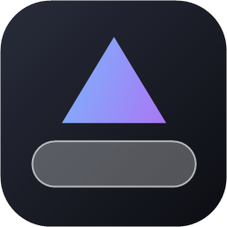
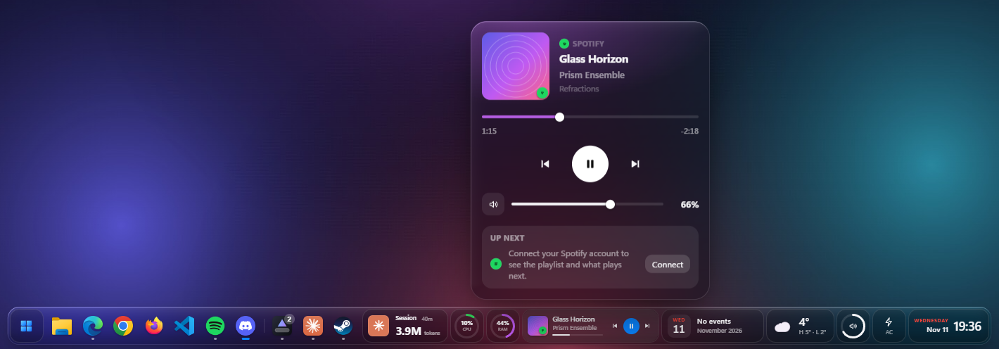
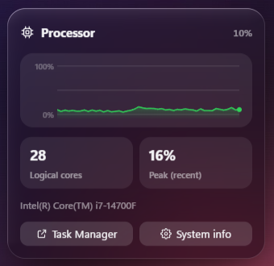
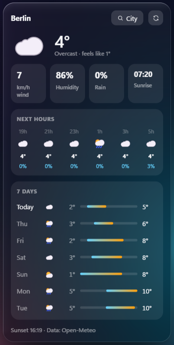
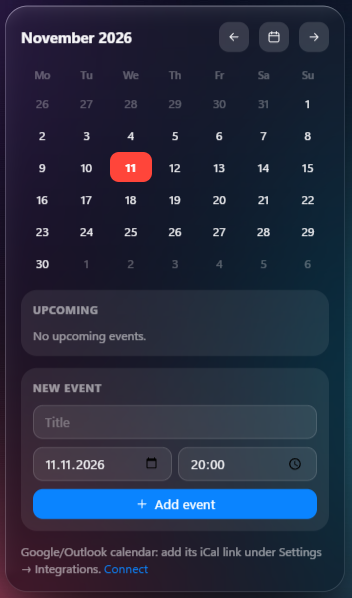
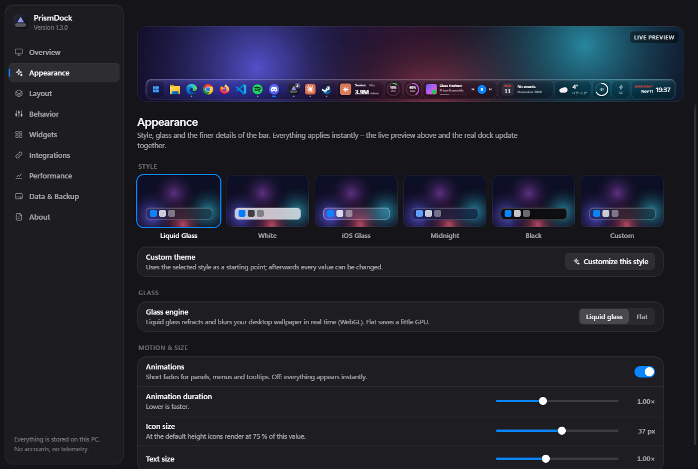
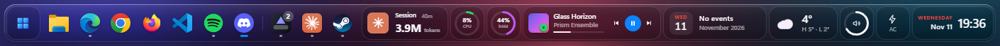
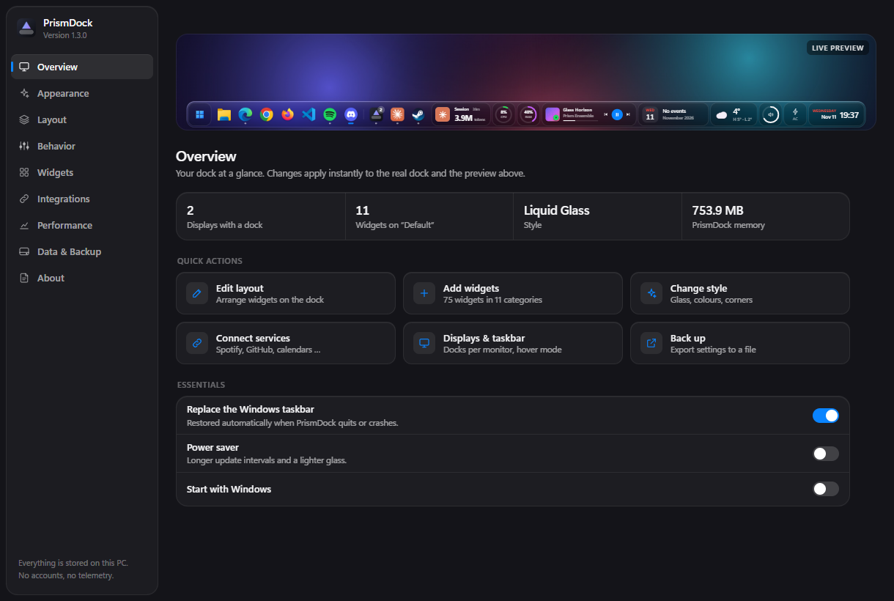
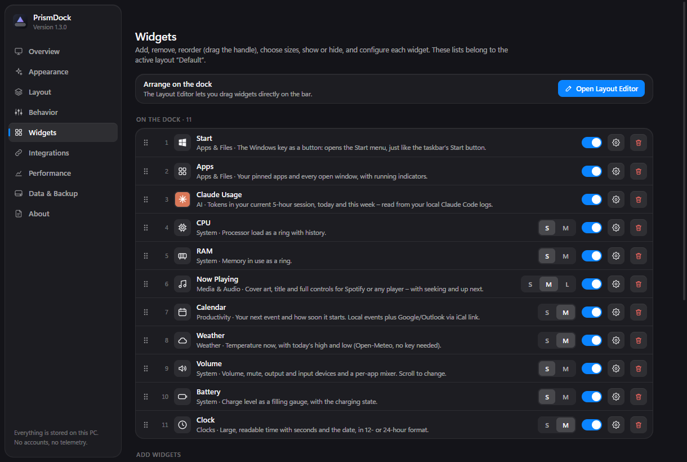

<div align="center">



# PrismDock

**A liquid-glass dock with live widgets that replaces the Windows taskbar.**

[](https://github.com/Nico-Buck/prismdock/actions/workflows/ci.yml)
[](LICENSE)




</div>

PrismDock puts a translucent, refractive bar on every monitor – with your apps, a Start button and
75 live widgets for system stats, media, calendars, weather, developer tools and more. It is fast
(≈0.12 % CPU idle on a 28-thread machine), runs entirely on your PC and has no accounts and no
telemetry.

<table>
  <tr>
    <td width="33%"></td>
    <td width="33%"></td>
    <td width="33%"></td>
  </tr>
  <tr>
    <td align="center"><sub>Live system graphs</sub></td>
    <td align="center"><sub>Weather without an API key</sub></td>
    <td align="center"><sub>Calendar with iCal sync</sub></td>
  </tr>
</table>

## Contents

- [Highlights](#highlights) · [Widgets](#widgets) · [Getting started](#getting-started) ·
  [Configuration](#configuration) · [Architecture](#architecture) · [Performance](#performance) ·
  [Security and privacy](#security-and-privacy) · [Limitations](#limitations) ·
  [Contributing](#contributing)

## Highlights

- **Real liquid glass.** A WebGL renderer refracts and blurs your wallpaper with lens edges,
  chromatic dispersion and rim light. Six styles: Liquid Glass, White, iOS Glass, Midnight, Black and
  a fully custom one.
- **Replaces the taskbar, safely.** The Windows taskbar is hidden and switched to auto-hide so
  Windows frees its space; the dock reserves its own strip. A WinEvent hook hides the taskbar again the
  moment Explorer re-shows it (Start menu, Explorer restart, sleep). The original state comes back on
  quit, after a crash (a 5 kB guardian process) and on the next start.
- **Every monitor.** One dock per display – all, main only or a selection – correct with mixed DPI,
  hot-plugging and stacked layouts. *Show only on hover* can be set per display.
- **Steps aside for full screen.** Videos and games get the whole display. Detection is
  event-driven and per monitor, so a full-screen video stays undisturbed while you work on another
  screen.
- **Live, not polled.** Volume follows your headset wheel in ~10 ms through Core Audio callbacks;
  media, CPU and network update through a subscription hub that stops everything nobody looks at.
- **Layout Editor on the bar itself.** Drag, resize, add and remove widgets, change spacing,
  alignment and position, and keep several saved layouts.
- **Spotify done right.** Playback, cover art, precise seeking and – with an optional sign-in
  (PKCE, no client secret) – the current playlist and what plays next.

<p align="center"></p>

<details>
<summary><b>More screenshots</b></summary>
<br>



| Overview | Widgets |
| --- | --- |
|  |  |

</details>

## Widgets

75 widgets in 11 categories, most in up to three sizes:

| Category | Widgets |
| --- | --- |
| System | CPU, RAM, GPU, Temperature, Network, Storage, Battery, Wi-Fi, Volume, Brightness, Quick Toggles, Recycle Bin |
| Media & Audio | Now Playing (Spotify and any Windows media session), Now Playing Bar/Mini, Playback Controls, Album Art, Audio Output with per-app mixer |
| Productivity | Calendar (local + iCal), To-dos, Notes, Pomodoro, Timer, Stopwatch, Day Timeline, Progress, Screen Time |
| Clocks | Clock, Date, Flip, Segment, Analog, World Clocks, 7 Days and more |
| Weather | Current, hourly, forecast, sunrise/sunset (Open-Meteo, no key) |
| Apps & Files | Start button, pinned/running apps, launcher, shortcuts, folders, recent files, screenshots, search |
| Developer | GitHub, GitHub Activity, LeetCode, Linear, Supabase |
| AI | Claude Code token usage, ChatGPT/Codex limits (read from local CLI logs) |
| Social & Finance | YouTube, Instagram, TikTok, X, Stripe, PayPal, Shopify revenue |
| Custom | Links/app launchers, values from any JSON API, text labels |

Services you have not connected show clearly labelled sample data. Adding a key under
**Settings → Integrations** switches the widget to live data immediately.

## Getting started

**Requirements:** Windows 10 (1903+) or Windows 11, x64, and Node.js 22+ for building. No other SDKs –
the native Windows integration is C# compiled at runtime by the built-in Windows PowerShell 5.1.

```bash
git clone https://github.com/Nico-Buck/prismdock.git
cd prismdock
npm install
npm start
```

| Script | What it does |
| --- | --- |
| `npm start` | Run from source |
| `npm run dev` | Run with the local test harness (see [CONTRIBUTING.md](CONTRIBUTING.md)) |
| `npm test` | Unit tests (Node's built-in runner, no extra dependencies) |
| `npm run dist` | Build an installer and a portable `.exe` into `dist/` |

On first start the app opens. The tray icon offers Settings, Edit layout, Show/hide dock and Quit.

<details>
<summary><b>Connecting Spotify (optional)</b></summary>

1. Create an app at developer.spotify.com/dashboard (Web API).
2. Add the redirect URI `http://127.0.0.1:43117/callback`.
3. Paste the Client ID under **Settings → Integrations → Spotify** and press **Connect**.

</details>

## Configuration

Everything is edited in the app and saved to `%APPDATA%\prismdock\`:

| File | Content |
| --- | --- |
| `config.json` | Settings, styles, widgets and saved layouts (see [`config.example.json`](config.example.json)) |
| `data.json` | Widget content: to-dos, notes, events, screen time |
| `secrets.bin` | API keys and tokens, encrypted with Windows DPAPI and bound to your account |
| `taskbar-restore.json` | The original taskbar state while PrismDock replaces it |

**Settings → Data & Backup** exports and imports the configuration; keys are never exported.

## Architecture

```
src/
  main/                       Electron main process
    main.js                   app lifecycle, dock/settings windows, tray, IPC, mouse forwarding
    displays.js               which monitors get a dock, window geometry, stable display keys
    taskbar.js                taskbar replacement and AppBar space reservation
    config.js                 configuration store: defaults, migration, layouts, secrets, import/export
    providers.js              local data sources (CPU, memory, media, windows, files, screen time …)
    integrations.js           online services (weather, GitHub, calendars, finance, social …)
    spotify.js                Spotify sign-in (PKCE) and Web API
    debug.js                  test harness, only with PRISM_DEBUG=1 on localhost
    native/
      bridge.js               JSON-lines channel to the helper (replies and pushed events)
      helper.ps1              Windows integration: Core Audio, media session (WinRT), taskbar hook,
                              full-screen watcher, AppBar, windows and icons, radios, DDC brightness
      guard.cs                tiny guardian that restores the taskbar if PrismDock crashes
  preload.js                  the only API the windows get (contextIsolation + sandbox)
  renderer/
    dock.html / dock.js       a dock window: wallpaper glass, click-through, show-on-hover
    settings.html/.js/.css    the PrismDock app
    shared/                   DockView, Layout Editor, glass renderer, charts, DOM patcher, hub, themes
    widgets/                  widget definitions by category
tests/                        unit tests
```

- **Data flow.** Widgets declare the topics they need (`cpu`, `media`, `integ:weather` …). Each
  window's hub polls only subscribed topics through IPC; the helper pushes events (volume, full
  screen) as they happen. Unsubscribed topics stop at once, and a hidden dock pauses its hub.
- **Rendering.** Widgets return HTML strings and `morph.js` applies only the differences, so live
  updates never rebuild nodes, restart images or flicker. The glass is redrawn only when a glass shape
  changes, and only inside its bounding box.

## Performance

Measured by sampling every PrismDock process (main, renderers, GPU, helper, guardian) on an
i7-14700F (28 threads) with two 1080p displays and 11 widgets, same profile for both versions. CPU is
the share of the whole machine.

| | 1.2.0 | 1.3.0 | Change |
| --- | --- | --- | --- |
| Idle CPU | 0.432 % | 0.124 % | −71 % |
| CPU with a live panel (CPU graph) open | 0.319 % | 0.157 % | −51 % |
| CPU while the mouse moves above the dock | 0.572 % | 0.291 % | −49 % |
| Idle memory (private bytes, all processes) | 557 MB | 456 MB | −18 % |
| Taskbar guardian process | 63 MB | 12 MB | −81 % |
| Start until the first dock is rendered | 2.53 s | 2.45 s | ±0 |

An 8-minute soak test (327 panel open/close cycles) showed no growth of JS heap, DOM nodes,
subscriptions or process memory.

## Security and privacy

- No account, no telemetry, no analytics. Online requests go only to services you connect, plus
  Open-Meteo for weather.
- Windows run with `contextIsolation`, `sandbox` and a strict Content-Security-Policy (remote images
  only from Spotify's image CDN); the renderer has no Node.js access.
- Secrets are stored with Electron `safeStorage` (Windows DPAPI), never written to `config.json`,
  never exported and only sent to their own service.
- The debug harness exists only with `PRISM_DEBUG=1` and listens on `127.0.0.1`.

Found a vulnerability? See [SECURITY.md](SECURITY.md).

## Limitations

- Windows does not let apps read other windows' pixels live, so the glass refracts the **desktop
  wallpaper**, not the windows behind the dock.
- Temperatures come from ACPI thermal zones (no kernel driver); GPU temperature on NVIDIA only.
- Gemini, Cursor and Grok have no public usage API; their tiles show labelled sample data.
- During an Explorer restart the dock disappears for a fraction of a second.

## Contributing

Issues and pull requests are welcome – please read [CONTRIBUTING.md](CONTRIBUTING.md) first. Changes
are listed in the [CHANGELOG](CHANGELOG.md).

## License

[MIT](LICENSE) © 2026 PrismDock contributors. PrismDock is an independent project with its own name,
icons and glass renderer; it is not affiliated with any other dock, launcher or the services it
connects to.
